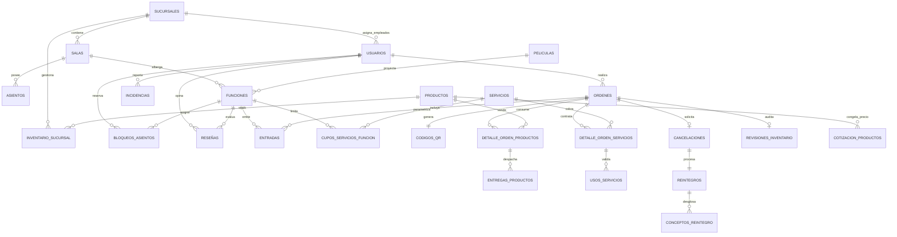

# Documentación del Esquema de Base de Datos — Cine Paradiso

**Proyecto:** Sistema de Venta de Entradas de Cine (Cine Paradiso)  
**Tarea asociada:** TASK-02 (Script de Creación de Base de Datos SQL)  
**Motor de BD:** MySQL 8.0+ (Engine: InnoDB, Charset: `utf8mb4_unicode_ci`)  
**Estrategia de Fechas:** Uso estricto de campos unificados `DATETIME` en lugar de separar fecha y hora.

---

## 1. Diagrama Entidad-Relación (ERD)

---

## 2. Estructura Modular y Resumen de Tablas

### Módulo 1: Cine, Salas y Cartelera
* **`sucursales`**: Locales físicos del complejo cinematográfico.
* **`salas`**: Espacios de proyección pertenecientes a una sucursal (`id_sucursal`).
* **`asientos`**: Grilla matricial de butacas (`fila`, `numero`, `tipo`) pertenecientes a una sala.
* **`peliculas`**: Registro local de películas (título, duración, sinopsis, poster) sincronizadas con la API externa.
* **`funciones`**: Horarios de proyección que relacionan una película con una sala en un instante `DATETIME`.

### Módulo 2: Usuarios y Autenticación
* **`usuarios`**: Gestión de clientes, empleados y administradores (`rol`: `CLIENTE`, `EMPLEADO`, `ADMIN`). Soporta vinculación opcional a una sucursal para restringir permisos operativos.

### Módulo 3: Bloqueos Temporales
* **`bloqueos_asientos`**: Reserva temporal de 5 minutos ($NOW() + 5\text{ min}$) durante la selección de butacas para prevenir la sobreventa concurrente.

### Módulo 4: Órdenes, Entradas y Códigos QR
* **`ordenes`**: Cabecera unificada de transacciones (compras de cine o pedidos exprés de Candy Bar).
* **`entradas`**: Entradas individuales emitidas por asiento e integradas en una orden de cine.
* **`codigos_qr`**: Códigos QR criptográficos únicos por orden para el acceso a sala (`ACCESO_SALA`) o retiro de productos (`RETIRO_CANDYBAR`).

### Módulo 5: Candy Bar, Inventario y Cotización
* **`productos`**: Catálogo de snacks, bebidas y combos.
* **`inventario_sucursal`**: Existencias y stock mínimo de cada producto por sucursal física.
* **`cotizacion_productos`**: Congelamiento de precios durante la ventana de 5 minutos de la orden.
* **`detalle_orden_productos`**: Ítems consumidos en cada orden.
* **`entregas_productos`**: Registro de entrega física en mostrador por parte del empleado.

### Módulo 6: Auditoría de Inventario No Retirado
* **`revisiones_inventario`**: Cabecera de inspección física única para pedidos en estado `NO_RETIRADO`.
* **`detalle_revision_inventario`**: Declaración de insumos recuperables devueltos al stock frente a desechos.

### Módulo 7: Servicios Adicionales
* **`servicios`**: Catálogo de adicionales (estacionamiento, acceso VIP, anteojos 3D).
* **`cupos_servicios_funcion`**: Límite de disponibilidad de servicios por función programada.
* **`detalle_orden_servicios`**: Servicios contratados dentro de una orden.
* **`usos_servicios`**: Control de validación física de servicios por parte del personal.

### Módulo 8: Incidencias, Cancelaciones y Reintegros
* **`incidencias`**: Registro de fallas técnicas o daños en butacas.
* **`reasignaciones_entradas`**: Reubicación de clientes ante contingencias.
* **`cancelaciones`**: Solicitudes de cancelación autogestionadas (hasta 60 minutos antes de la función) o por fuerza mayor.
* **`reintegros`**: Comprobante de devolución monetaria simulada.
* **`conceptos_reintegro`**: Desglose ítem por ítem del monto reembolsado.

### Módulo 9: Reseñas y Puntuaciones (Extra/Deseable)
* **`reseñas`**: Calificación (1 a 5 estrellas) y comentarios habilitados únicamente para usuarios que hayan asistido a la función.

---

## 3. Principales Reglas de Negocio Implementadas

1. **Campos Temporalmente Unificados:** Todos los eventos temporales utilizan el tipo `DATETIME` para simplificar comparaciones de rangos y evitar inconsistencias de husos horarios.
2. **Control Concurrente por Bloqueos:** Los registros en `bloqueos_asientos` caducan automáticamente a los 5 minutos si la orden no pasa a estado `CONFIRMADA`.
3. **Inmutabilidad de Datos Financieros:** Los valores unitarios se congelan en tablas de detalle (`entradas`, `detalle_orden_productos`, `cotizacion_productos`) para preservar la integridad histórica aunque cambie el catálogo.
4. **Validación Antisolapamiento de Funciones:** Las funciones programadas contemplan un margen de limpieza/desalojo en la sala física antes de admitir un nuevo espectáculo.
