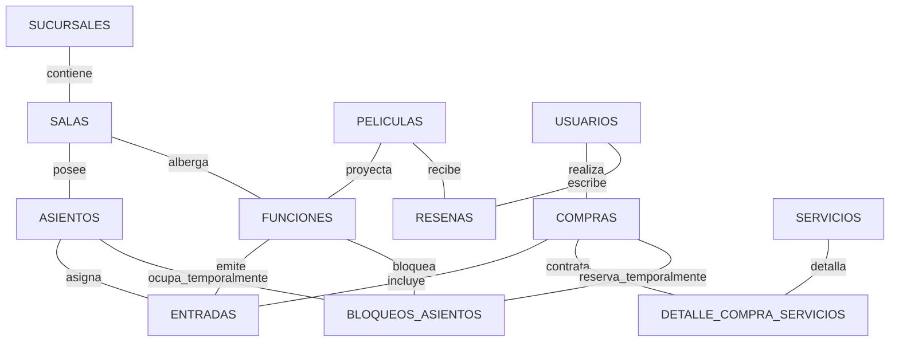

# Documentación del Esquema de Base de Datos — Cine Paradiso

* **Base de datos:** `cine_paradiso`
* **Motor:** MySQL 8.0+
* **Estrategia temporal:** Uso unificado de `DATETIME` para fechas y horarios de funciones, compras, bloqueos y reseñas.
* **Total de tablas:** 12 tablas relacionales + 1 evento programado (`expirar_compras_pendientes`).

---

## 1. Diagrama Entidad-Relación (ERD)



---

## 2. Detalle de Tablas

### 2.1. `sucursales`
Almacena los complejos cinematográficos de la cadena.

| Columna | Tipo de dato | Nulo | Clave / Restricción | Descripción |
| :--- | :--- | :--- | :--- | :--- |
| `id_sucursal` | `INT` | NO | `PRIMARY KEY`, `AUTO_INCREMENT` | Identificador único de la sucursal. |
| `nombre` | `VARCHAR(100)` | NO | — | Nombre comercial de la sucursal. |
| `direccion` | `VARCHAR(150)` | NO | — | Dirección física del complejo. |
| `ciudad` | `VARCHAR(100)` | NO | — | Ciudad o localidad donde se ubica. |

---

### 2.2. `salas`
Almacena las salas de proyección pertenecientes a cada sucursal.

| Columna | Tipo de dato | Nulo | Clave / Restricción | Descripción |
| :--- | :--- | :--- | :--- | :--- |
| `id_sala` | `INT` | NO | `PRIMARY KEY`, `AUTO_INCREMENT` | Identificador único de la sala. |
| `id_sucursal` | `INT` | NO | `FOREIGN KEY` → `sucursales(id_sucursal)` (`ON DELETE CASCADE`) | Sucursal a la que pertenece la sala. |
| `nombre` | `VARCHAR(50)` | NO | — | Nombre o número identificador de la sala (ej. `Sala 1`). |
| `capacidad` | `INT` | NO | — | Cantidad total de butacas generadas para la sala. |

---

### 2.3. `asientos`
Representa cada butaca física dentro de una sala, identificada por fila y número.

| Columna | Tipo de dato | Nulo | Clave / Restricción | Descripción |
| :--- | :--- | :--- | :--- | :--- |
| `id_asiento` | `INT` | NO | `PRIMARY KEY`, `AUTO_INCREMENT` | Identificador único de la butaca. |
| `id_sala` | `INT` | NO | `FOREIGN KEY` → `salas(id_sala)` (`ON DELETE CASCADE`) | Sala a la que pertenece el asiento. |
| `fila` | `VARCHAR(5)` | NO | `UNIQUE (id_sala, fila, numero)` | Letra o código de fila (ej. `A`, `B`). |
| `numero` | `INT` | NO | `UNIQUE (id_sala, fila, numero)` | Número de asiento dentro de la fila. |

* **Restricción única:** `uq_asiento_sala UNIQUE (id_sala, fila, numero)` — impide duplicar una misma coordenada de asiento dentro de una misma sala.

---

### 2.4. `peliculas`
Catálogo local de películas importadas desde la API externa (TMDb / OMDb).

| Columna | Tipo de dato | Nulo | Clave / Restricción | Descripción |
| :--- | :--- | :--- | :--- | :--- |
| `id_pelicula` | `INT` | NO | `PRIMARY KEY`, `AUTO_INCREMENT` | Identificador único de la película en el catálogo local. |
| `titulo` | `VARCHAR(150)` | NO | — | Título de la película. |
| `sinopsis` | `TEXT` | SÍ | — | Descripción argumental de la película. |
| `poster_url` | `VARCHAR(255)` | SÍ | — | URL del póster oficial. |
| `genero` | `VARCHAR(50)` | NO | — | Género cinematográfico principal. |
| `duracion_min` | `INT` | NO | — | Duración total de la película en minutos. |
| `clasificacion` | `VARCHAR(20)` | NO | — | Clasificación por edad (ej. `ATP`, `+13`, `+16`). |

---

### 2.5. `funciones`
Programación de proyecciones de una película en una sala, fecha y horario específicos.

| Columna | Tipo de dato | Nulo | Clave / Restricción | Descripción |
| :--- | :--- | :--- | :--- | :--- |
| `id_funcion` | `INT` | NO | `PRIMARY KEY`, `AUTO_INCREMENT` | Identificador único de la función. |
| `id_pelicula` | `INT` | NO | `FOREIGN KEY` → `peliculas(id_pelicula)` (`ON DELETE CASCADE`) | Película proyectada en la función. |
| `id_sala` | `INT` | NO | `FOREIGN KEY` → `salas(id_sala)` (`ON DELETE RESTRICT`) | Sala donde se realiza la proyección. |
| `fecha_hora` | `DATETIME` | NO | — | Fecha y hora de inicio de la función en un único campo. |
| `precio_entrada` | `DECIMAL(10,2)` | NO | — | Valor unitario vigente de la entrada para esta función. |

---

### 2.6. `usuarios`
Cuentas de clientes y administradores registrados en el sistema.

| Columna | Tipo de dato | Nulo | Clave / Restricción | Descripción |
| :--- | :--- | :--- | :--- | :--- |
| `id_usuario` | `INT` | NO | `PRIMARY KEY`, `AUTO_INCREMENT` | Identificador único del usuario. |
| `nombre` | `VARCHAR(100)` | NO | — | Nombre completo del usuario. |
| `email` | `VARCHAR(100)` | NO | `UNIQUE` | Correo electrónico único utilizado para login y comprobantes. |
| `password_hash` | `VARCHAR(255)` | NO | — | Hash criptográfico de la contraseña. |
| `rol` | `ENUM('CLIENTE', 'ADMIN')` | NO | `DEFAULT 'CLIENTE'` | Rol de acceso en el sistema (`CLIENTE` o `ADMIN`). |

---

### 2.7. `compras`
Cabecera de cada operación de compra realizada por un usuario, junto con su estado y código QR.

| Columna | Tipo de dato | Nulo | Clave / Restricción | Descripción |
| :--- | :--- | :--- | :--- | :--- |
| `id_compra` | `INT` | NO | `PRIMARY KEY`, `AUTO_INCREMENT` | Identificador único de la compra. |
| `id_usuario` | `INT` | NO | `FOREIGN KEY` → `usuarios(id_usuario)` (`ON DELETE CASCADE`) | Cliente que realiza la compra. |
| `fecha_compra` | `DATETIME` | NO | `DEFAULT CURRENT_TIMESTAMP` | Fecha y hora de creación de la compra. |
| `monto_total` | `DECIMAL(10,2)` | NO | — | Importe total calculado (entradas + servicios). |
| `estado_compra` | `ENUM('PENDIENTE', 'CONFIRMADA', 'CANCELADA', 'EXPIRADA')` | NO | `DEFAULT 'PENDIENTE'` | Estado del ciclo de vida de la compra. |
| `codigo_qr` | `VARCHAR(100)` | SÍ | `UNIQUE` | Código identificador único del QR generado al confirmar. |
| `estado_qr` | `ENUM('PENDIENTE', 'USADO', 'CANCELADO')` | SÍ | — | Estado operativo del código QR para control de acceso. |

---

### 2.8. `entradas`
Detalle de entradas emitidas por función y butaca dentro de una compra.

| Columna | Tipo de dato | Nulo | Clave / Restricción | Descripción |
| :--- | :--- | :--- | :--- | :--- |
| `id_entrada` | `INT` | NO | `PRIMARY KEY`, `AUTO_INCREMENT` | Identificador único de la entrada. |
| `id_compra` | `INT` | NO | `FOREIGN KEY` → `compras(id_compra)` (`ON DELETE CASCADE`) | Compra a la que pertenece la entrada. |
| `id_funcion` | `INT` | NO | `FOREIGN KEY` → `funciones(id_funcion)` (`ON DELETE RESTRICT`) | Función asociada a la entrada. |
| `id_asiento` | `INT` | NO | `FOREIGN KEY` → `asientos(id_asiento)` (`ON DELETE RESTRICT`) | Butaca asignada a la entrada. |
| `precio` | `DECIMAL(10,2)` | NO | — | Precio histórico abonado por la entrada al momento de comprar. |

* **Restricción única:** `uq_funcion_asiento UNIQUE (id_funcion, id_asiento)` — garantiza a nivel de motor SQL que una butaca no pueda venderse dos veces para la misma función.
* **Comportamiento ante cancelación:** Al cancelarse una compra (`estado_qr = 'CANCELADO'`), se eliminan sus registros en `entradas` para liberar las butacas inmediatamente.

---

### 2.9. `servicios`
Catálogo global de servicios adicionales disponibles para complementar una compra.

| Columna | Tipo de dato | Nulo | Clave / Restricción | Descripción |
| :--- | :--- | :--- | :--- | :--- |
| `id_servicio` | `INT` | NO | `PRIMARY KEY`, `AUTO_INCREMENT` | Identificador único del servicio. |
| `nombre` | `VARCHAR(100)` | NO | — | Nombre del producto o servicio adicional. |
| `descripcion` | `VARCHAR(255)` | SÍ | — | Detalle descriptivo del servicio. |
| `tipo` | `ENUM('COMIDA', 'BEBIDA', 'COMBO', 'ESTACIONAMIENTO', 'VIP', 'OTRO')` | NO | — | Categoría del servicio. |
| `precio` | `DECIMAL(10,2)` | NO | — | Precio unitario vigente en el catálogo. |

---

### 2.10. `detalle_compra_servicios`
Relación N:M entre compras y servicios adicionales contratados, preservando el precio unitario histórico.

| Columna | Tipo de dato | Nulo | Clave / Restricción | Descripción |
| :--- | :--- | :--- | :--- | :--- |
| `id_detalle` | `INT` | NO | `PRIMARY KEY`, `AUTO_INCREMENT` | Identificador único de la línea de detalle. |
| `id_compra` | `INT` | NO | `FOREIGN KEY` → `compras(id_compra)` (`ON DELETE CASCADE`) | Compra asociada. |
| `id_servicio` | `INT` | NO | `FOREIGN KEY` → `servicios(id_servicio)` (`ON DELETE CASCADE`) | Servicio contratado. |
| `cantidad` | `INT` | NO | — | Cantidad de unidades contratadas. |
| `precio_unitario` | `DECIMAL(10,2)` | NO | — | Precio unitario congelado al momento de la compra. |

---

### 2.11. `bloqueos_asientos`
Gestiona el bloqueo temporal de butacas por función durante el proceso de compra antes de su confirmación o expiración.

| Columna | Tipo de dato | Nulo | Clave / Restricción | Descripción |
| :--- | :--- | :--- | :--- | :--- |
| `id_funcion` | `INT` | NO | `PRIMARY KEY (id_funcion, id_asiento)`, `FOREIGN KEY` → `funciones(id_funcion)` (`ON DELETE CASCADE`) | Función sobre la cual se bloquea el asiento. |
| `id_asiento` | `INT` | NO | `PRIMARY KEY (id_funcion, id_asiento)`, `FOREIGN KEY` → `asientos(id_asiento)` (`ON DELETE CASCADE`) | Butaca bloqueada temporalmente. |
| `id_compra` | `INT` | NO | `INDEX idx_bloqueos_asientos_compra`, `FOREIGN KEY` → `compras(id_compra)` (`ON DELETE CASCADE`) | Compra pendiente que origina el bloqueo. |
| `precio_entrada` | `DECIMAL(10,2)` | NO | `DEFAULT 0.00` | Precio de la entrada congelado durante el bloqueo. |
| `vence_en` | `DATETIME` | NO | — | Marca temporal límite de vigencia del bloqueo. |
| `estado` | `ENUM('ACTIVO', 'CONFIRMADO', 'EXPIRADO', 'LIBERADO')` | NO | `DEFAULT 'ACTIVO'` | Estado actual del bloqueo de la butaca. |

---

### 2.12. `resenas`
Almacena las puntuaciones y comentarios de los usuarios sobre películas a las que asistieron.

| Columna | Tipo de dato | Nulo | Clave / Restricción | Descripción |
| :--- | :--- | :--- | :--- | :--- |
| `id_resena` | `INT` | NO | `PRIMARY KEY`, `AUTO_INCREMENT` | Identificador único de la reseña. |
| `id_usuario` | `INT` | NO | `FOREIGN KEY` → `usuarios(id_usuario)` (`ON DELETE CASCADE`) | Autor de la reseña. |
| `id_pelicula` | `INT` | NO | `FOREIGN KEY` → `peliculas(id_pelicula)` (`ON DELETE CASCADE`) | Película reseñada. |
| `puntuacion` | `TINYINT` | NO | `CHECK (puntuacion BETWEEN 1 AND 5)` | Calificación entera entre `1` y `5`. |
| `comentario` | `TEXT` | SÍ | — | Comentario opcional del espectador. |
| `fecha` | `DATETIME` | NO | `DEFAULT CURRENT_TIMESTAMP` | Fecha y hora de publicación de la reseña. |

* **Restricción única:** `uq_usuario_pelicula UNIQUE (id_usuario, id_pelicula)` — permite como máximo una reseña por usuario y película.

---

## 3. Automatización en Base de Datos (MySQL Event Scheduler)

El esquema habilita `SET GLOBAL event_scheduler = ON` y define el evento recurrente **`expirar_compras_pendientes`**, que se ejecuta cada **1 segundo**:

1. Cambia `compras.estado_compra` de `'PENDIENTE'` a `'EXPIRADA'` cuando existe al menos un registro asociado en `bloqueos_asientos` con `estado = 'ACTIVO'` cuya marca `vence_en <= NOW()`.
2. Actualiza simultáneamente `bloqueos_asientos.estado` de `'ACTIVO'` a `'EXPIRADO'` para las compras expiradas, liberando los asientos de forma automática.
````[cite: 1]
